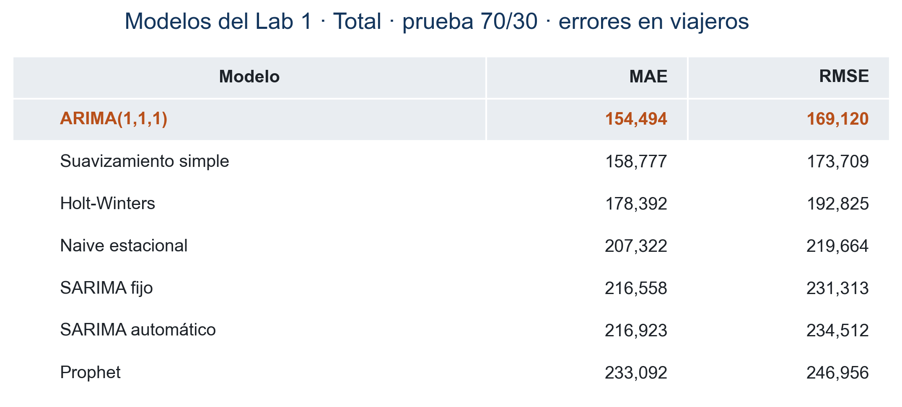
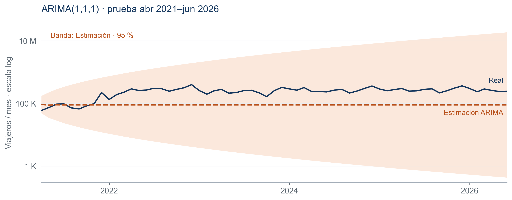

# Laboratorio 9 — Visualización estática

Universidad del Valle de Guatemala · Ciencia de Datos (CC3084)

Nicolás Concuá — 23197 · Felipe Aguilar — 23195

Documento final de decisiones de diseño · 16 de octubre de 2026

## 1. Propósito, audiencia y pregunta guía

La infografía sintetiza los resultados del Laboratorio 1 sobre el ingreso de viajeros a Guatemala, de enero de 2009 a junio de 2026, para un directivo de INGUAT sin formación estadística. Cada pieza responde a una pregunta y los títulos presentan conclusiones, no nombres de técnicas. La pregunta guía es: ¿qué nos enseñan 17 años de datos migratorios sobre el turismo en Guatemala y qué debemos anticipar hacia el futuro?

El titular final, «El turismo se recupera, pero no al mismo ritmo», resume la diferencia entre la recuperación de los mercados y la del Total. Las cifras mantienen las definiciones del Lab 1: Total = Turista + Excursionista; Marítima = cruceristas de 2009 a 2022; mercados = El Salvador, EE. UU. y Honduras. Se conservan las decisiones de los bloques 1–3 del avance y se completan los bloques 4–5 y el montaje.

## 2. Orden de los bloques y trayectoria visual

La lectura es vertical, de arriba abajo, con títulos alineados a la izquierda que permiten escanear en patrón F. El orden responde a contexto → explicación → predicción → acción. El titular y cuatro KPIs atraen la atención; la línea histórica explica el colapso; el patrón mensual y el cuadrante comparan temporadas, vías y mercados; los modelos muestran la incertidumbre; las recomendaciones cierran con decisiones institucionales.

Los bloques 1–2 ocupan aproximadamente el primer 31 % del lienzo; el bloque 3, el 35 %; el bloque 4, el 17 %; y el cierre con fuentes, el 17 %. Se reserva más espacio al cuadrante porque debe responder cuatro preguntas con seis series. El mapa de calor y la curva de recuperación permanecen como piezas de apoyo en outputs, pero no se duplican en el lienzo: la estacionalidad ya tiene su gráfico y la recuperación se resume en una frase. Así se conserva espacio para el pronóstico y las recomendaciones.

## 3. Paleta y teoría del color

Se conserva la base fría del avance: azul marino #14365D para Total y vías, y verde azulado #1F7A7A para mercados. La cercanía entre estos tonos mantiene armonía; el naranja #E8702A introduce contraste cálido frente al azul para destacar anomalías, líderes y la banda proyectada. El color sirve para jerarquizar, no para decorar. La asociación institucional del azul acompaña el propósito ejecutivo, sin convertirla en una regla universal.

El fondo es blanco; #E9EDF1 separa tarjetas y encabezados sin bordes pesados. El gris #A3ADB8 se usa en trazos y rellenos de contexto, nunca en texto pequeño. Los textos usan #1E2329 o #5B6670; el naranja oscuro #B8501A se reserva para etiquetas que requieren más contraste. Las líneas real y estimada se distinguen también por trazo continuo/discontinuo, y los ganadores llevan sus valores: la lectura no depende solo del color. No se utilizan efectos 3D, sombras ni una paleta arcoíris.

## 4. Tipografía, formato y legibilidad

Se utiliza Arial, una familia sans serif disponible en el equipo de generación. El tamaño y el peso establecen la jerarquía: titular y KPIs grandes, encabezados de bloque intermedios y notas menores. Las etiquetas aparecen junto a barras y líneas para reducir búsquedas en leyendas. Los textos pequeños se mantienen oscuros sobre blanco.

El PNG tiene exactamente 1200 × 2400 píxeles. El PDF conserva texto y gráficos vectoriales en una página de 11 × 17 pulgadas; los tamaños tipográficos se ajustan a esa proporción. El enunciado denomina «A3» a 11 × 17, pero el A3 ISO mide 297 × 420 mm. Se sigue la medida explícita de 11 × 17 pulgadas, dejando constancia de la diferencia para la entrega.

## 5. Decisiones por bloque y tipo de gráfico

### 5.1. Titular y tarjetas KPI

Cuatro tarjetas muestran 46.7 millones de viajeros acumulados, el récord anual de 4.13 millones en 2019, la caída del 94 % en abril–diciembre de 2020 frente al mismo período de 2019 y la recuperación del 81 % de ese nivel en 2025. Cada tarjeta incluye unidad y período. No se compara el primer semestre de 2026 con un año completo. El fondo tenue agrupa cifra y significado sin agregar decoración.

### 5.2. Panorama histórico

La línea es adecuada para una variable cuantitativa mensual ordenada en el tiempo. Los datos se dibujan en gris y el promedio móvil centrado de 12 meses en azul para distinguir fluctuación y tendencia. El eje comienza en cero. Las anotaciones ubican Agatha/Pacaya, el Volcán de Fuego, el cierre de fronteras y el cambio de clasificación de 2023. Estos eventos aportan contexto, pero el gráfico no demuestra que expliquen causalmente cada cambio. El período pandémico lleva un sombreado tenue.

### 5.3. Estacionalidad, vías y mercados

Las barras divergentes parten de 100: cada mes se expresa como porcentaje del promedio de su año, no como cantidad absoluta. Se excluyen 2020–2022 y 2026 parcial. Diciembre alcanza 134; febrero y septiembre rondan 83. Las notas de Semana Santa, vacaciones, Bono 14 y fiestas son referencias de calendario, no efectos causales estimados. Semana Santa puede cambiar de mes.

El cuadrante usa barras horizontales porque compara categorías nominales con nombres largos. En cada panel se separan vías y mercados y se destaca al líder de cada grupo. Mayor fuerza estacional: Aérea (0.90) y EE. UU. (0.94); mayor crecimiento pre-COVID: Marítima (16.7 % anual) y El Salvador (12.0 %); mayor variación irregular: Marítima (2.01) y El Salvador (0.14); mayor caída pandémica: Marítima (100 %) y El Salvador (98.7 %). Las barras tienen base cero y cada panel su propia escala, pues las unidades son diferentes.

La volatilidad es la desviación del residuo en escala logarítmica, no una desviación de viajeros. La estacionalidad es un índice entre 0 y 1. Los indicadores se calculan sobre el período pre-COVID, salvo la caída que compara abril–diciembre de 2020 con 2019. Marítima usa cruceristas, tiene meses en cero y termina en 2022; no es directamente intercambiable con las otras vías. La recuperación de los tres mercados por encima de 2019 se resume al pie, sin confundirla con el Total.

### 5.4. Modelos y pronóstico

Se elige una tabla para presentar MAE y RMSE de los siete candidatos de Total sin superponer barras con métricas similares. Las filas se ordenan por RMSE ascendente; ambos errores se expresan en viajeros mensuales y menor significa mejor. El ganador se destaca en naranja oscuro. Las cifras proceden de la salida de la sección 21 de Lab1_Series_Tiempo.ipynb: ARIMA(1,1,1), suavizamiento simple, Holt-Winters, naive estacional, SARIMA fijo, SARIMA automático y Prophet. El CSV conserva los resultados con dos decimales; la infografía redondea a viajeros.

Todos corresponden a la misma partición temporal 70/30: 147 meses para entrenar, enero de 2009–marzo de 2021, y 63 meses para prueba, abril de 2021–junio de 2026. ARIMA(1,1,1) obtiene MAE 154,494.17 y RMSE 169,119.58. No se mezcla esta tabla con la evaluación de los últimos 24 meses, donde gana Holt-Winters con MAE 17,581.15 y RMSE 20,776.87. Esa diferencia se comunica como sensibilidad al horizonte, no como una mejora comparable entre pruebas distintas.

El gráfico reproduce el ajuste SARIMAX del notebook sobre log(Total), usando solo entrenamiento. Se invierte el pronóstico con exp, como en Lab 1: la línea es la mediana implícita de esa transformación, sin corrección adicional de media lognormal. Se añaden los límites del intervalo predictivo puntual del 95 % mediante get_forecast().conf_int(alpha=0.05), también invertidos con exp. El intervalo no estaba dibujado en Lab 1 y se calcula aquí para cumplir el enunciado; no se construye a partir del error observado en prueba.

La línea real es azul continua; la estimación, naranja oscura discontinua; y la incertidumbre, una banda naranja translúcida rotulada «Estimación · 95 %». Al final del horizonte la banda se extiende aproximadamente de 432 a 18.8 millones de viajeros mensuales: el resultado revela la poca precisión de extrapolar desde el piso pandémico. Para mostrar ambos límites completos sin aplastar las líneas se usa un eje logarítmico explícito, con marcas 1 K, 100 K y 10 M. Distancias iguales representan razones, no incrementos absolutos; no se debe interpretar visualmente como un eje lineal.

Este es un pronóstico retrospectivo sobre prueba, no una proyección posterior a junio de 2026. El 95 % es condicional al modelo y no una garantía simultánea ni cobertura de cambios estructurales. La amplitud se conserva: recortarla produciría una falsa sensación de certeza. La recomendación ejecutiva es revalidar con información reciente y trabajar con escenarios.

### 5.5. Recomendaciones y ficha técnica

Cuatro recomendaciones conectan cada decisión con un hallazgo. Primero, preparar capacidad y promoción antes de diciembre, cuyo índice es 134, ajustando Semana Santa a su fecha anual. Segundo, probar campañas segmentadas en El Salvador, EE. UU. y Honduras, que superan 2019, y medir llegadas antes de escalar el gasto. Tercero, revisar capacidad aérea y terrestre por separado y mantener contingencias: el Total sigue en 81 % de 2019 y no hay datos de cruceros posteriores a 2022. Cuarto, actualizar mensualmente y revalidar pronósticos, porque el ganador depende del horizonte y el test largo tiene errores elevados.

Se usan dos columnas de texto breve, sin iconos decorativos. El pie identifica Base de Migración 2009–2026, INGUAT/IGM, el período y las definiciones, y acredita a Nicolás Concuá (23197) y Felipe Aguilar (23195). También advierte el uso académico y la restricción de difusión pública.

## 6. Integridad de la representación

Los ejes de magnitud comienzan en cero, salvo las excepciones explícitas: índice estacional con referencia 100 y pronóstico con escala logarítmica. No se recorta la banda predictiva ni se mezclan horizontes para seleccionar un ganador. Las fechas y unidades acompañan cada comparación; 2026 parcial queda fuera de comparaciones anuales y el quiebre de clasificación de 2023 se señala. Los hallazgos son descriptivos: no prueban causas ni garantizan demanda futura.

## 7. Herramientas, fuentes y reproducibilidad

El avance conserva programa/data_prep.py, programa/style.py y programa/charts_blocks_1_3.py. programa/forecast.py reproduce ARIMA y exporta fechas, estimaciones, límites y métricas; programa/infografia.py genera el montaje final y las piezas del bloque 4; programa/documento.py convierte esta fuente editable en PDF. La base Excel queda en data/raw y no se versiona. Los resultados tabulados del Lab 1 se conservan en data/processed/modelos_total_lab1.csv, con sus órdenes y procedencia detallados en el README.

El repositorio de trabajo es https://github.com/nicoCT04/Lab9-DataScience. Las fuentes editables de los entregables son este Markdown y el script del montaje. Su historial registra las contribuciones; se requiere acceso del docente y auxiliares al repositorio autorizado. No se publica la infografía ni la base sin consulta previa, por la restricción académica del enunciado.

## 8. Contraste con la rúbrica

Documento de explicación, 45 puntos: se explican audiencia, orden, jerarquía, teoría de color, tipografía, selección de gráficos, escalas y decisiones de los cinco bloques. El texto describe las piezas finales, no acciones pendientes.

Infografía, 55 puntos: incluye titular narrativo, cuatro KPIs, panorama anotado, estacionalidad con calendario, las cuatro comparaciones por vía y mercado, siete modelos con MAE/RMSE, estimación con banda explícita del 95 %, cuatro recomendaciones y fuente/autores. Se generan PNG 1200 × 2400 y PDF de una página 11 × 17, y se verifica visualmente la lectura.

No se asigna una nota automática: la calidad final depende de la evaluación docente. Quedan fuera de la comprobación local la inscripción del grupo en Canvas, el acceso del docente y auxiliares, los enlaces accesibles en el medio autorizado y las entregas dentro de plazo (avance: 15 de octubre; entrega final: 18 de octubre de 2026).
